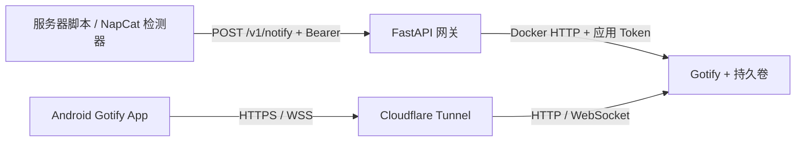

# 自托管统一通知网关

Python + FastAPI → Gotify → Android。网关等待 Gotify 返回消息 ID 后才向调用方返回成功；业务脚本只持有网关 Token。当前支持单个接收用户、一个 Gotify 应用，默认纯文本，支持显式图片和操作链接。

架构评审、与 Server酱的取舍、二维码扩展及可靠性边界见 [架构审查](docs/architecture-review.md)。密钥全部保留占位，不包含服务器现有凭据。

已完成 42 项自动化测试和真实 Docker 环境集成测试，详见 [验证记录](docs/validation.md)。用户已确认收到普通通知及 QQ 离线告警，且能在手机打开登录页并看到二维码。

部署域名支持通过 `.env` 中的 `NAPCAT_PUBLIC_URL` 配置（如 `https://gotify.example.com`），建议创建专用接收用户 `notifications`。手机使用步骤见 [Android 使用说明](docs/android-usage.md)，QQ 监控、刷新二维码和运维见 [NapCat 接入说明](docs/napcat-watch.md)。



## 部署

前提：服务器已经安装 Docker 和 Compose v2，已有域名及可用的 Cloudflare Tunnel。下面不安装或升级系统软件。

### 1. 准备配置

把整个 `notify-stack/` 上传到服务器，例如 `~/services/notify-stack`，然后执行：

```bash
cd ~/services/notify-stack
cp .env.example .env
chmod 600 .env
python3 -c 'import secrets; print(secrets.token_urlsafe(32)); print(secrets.token_urlsafe(32))'
```

将生成的两个不同随机值分别填入 `.env` 的 `GATEWAY_API_TOKEN` 和 `GOTIFY_ADMIN_PASSWORD`。先保留 `GOTIFY_APP_TOKEN` 占位，稍后创建应用后再填。不要把 `.env` 提交到 Git，也不要把 `docker compose config` 的完整展开结果发到公共日志或聊天中。

默认本机端口为 Gotify `127.0.0.1:8080`、网关 `127.0.0.1:8090`；占用时修改 `.env` 中的端口。Gotify 使用官方镜像 `3.1.1`，网关使用 Python `3.12.14`；所有 Python 运行时依赖在 `gateway/requirements.txt` 中固定版本。

### 2. 先启动 Gotify

```bash
docker compose config --quiet
docker compose up -d gotify
docker compose ps
curl --fail-with-body http://127.0.0.1:8080/health
```

Gotify 的数据库和应用数据保存在项目命名卷 `notify-stack_gotify-data`。管理员用户名、密码环境变量仅用于首次初始化；已有数据库的改密需在 Gotify 中操作。

### 3. 配置已有 Cloudflare Tunnel

将 `gotify.example.com` 替换成自己的子域名。**只发布 Gotify，不发布网关。**

如果 cloudflared 直接运行在宿主机，服务地址填：

```text
http://127.0.0.1:8080
```

如果 cloudflared 是已有 Docker 容器，推荐在它自己的 Compose 中加入本项目网络：

```yaml
services:
  cloudflared: # 替换成已有的服务名，合并到原配置
    networks:
      - original-network
      - notify
networks:
  # 保留原网络定义
  notify:
    external: true
    name: notify-stack_notify
```

保留该服务原本的网络，然后仅重建 cloudflared 服务来应用。Tunnel 公共主机名的服务地址填写：

```text
http://gotify:80
```

不要在普通 cloudflared 容器里填写 `127.0.0.1:8080`，那会访问容器自己。若使用 `docker compose -p other-name`，上面的网络名称也要改为 `other-name_notify`。也可在已有 cloudflared Compose 中通过服务网络别名避免同名服务冲突。

确认 Cloudflare WebSocket 开启，且 WAF/Access 没有对 Android 的登录和 `/stream` 连接返回网页验证。初期使用 Gotify 自身的登录认证和强密码，保持公开注册关闭。不要直接给整个域名套上需要浏览器交互的 Cloudflare Access 登录；官方 Android 客户端不能假定能完成这种额外认证。

也可使用本项目自带的独立 `cloudflared` 服务，避免改动已有隧道。它通过可选的 `tunnel` Compose profile 启用：

1. 授权、创建隧道前，核对 Cloudflare 实际授权的站点与目标域名一致。`tunnel route dns` 可能将不属于所选站点的名称当成相对名称，追加站点后缀；不能只根据命令退出成功就判断域名正确。
2. 以 [cloudflared/config.yml.example](cloudflared/config.yml.example) 创建 `cloudflared/config.yml`，填入隧道 UUID 和最终主机名。
3. 隧道运行凭据保存为 `.secrets/cloudflared-runtime/tunnel.json`，设为 400，并确保容器用户 `65532:65532` 可读。账户授权证书仅用于管理，不挂载给常驻容器。
4. 在 `.env` 设置 `COMPOSE_PROFILES=tunnel`，执行 `docker compose up -d --wait cloudflared`。此服务与 Gotify 共享内部网络，不发布宿主机端口，健康检查使用 cloudflared 自带的 `tunnel ready`。

配置和凭据路径已加入 `.gitignore`。正式验收同时检查公网 `/health`、TLS 证书以及 `/stream` 的 WebSocket 101 握手和实际收件。

临时管理也可以使用 SSH 转发：

```bash
ssh -F ~/.ssh/config -o ControlMaster=no -o ControlPath=none -N \
  -L 18080:127.0.0.1:8080 your-server
```

在电脑打开 `http://127.0.0.1:18080`。如果 HTTP 本地登录受 Secure Cookie 影响，可以临时将 `.env` 中 `GOTIFY_SECURE_COOKIE=false` 并仅重建 Gotify；启用公网 HTTPS 后设回 `true`。SSH 配置别名可按自己的环境替换。

### 4. 创建接收用户与应用

1. 打开 `https://gotify.example.com`，用 `.env` 的管理员账户登录。
2. 创建普通用户，例如 `notifications`，为该用户设置独立密码；退出管理员。
3. 用 `notifications` 登录，在 Apps/应用中创建 `notification-gateway`。
4. 将创建时展示的 **Application Token** 填入 `.env` 的 `GOTIFY_APP_TOKEN`。Gotify 3 只在创建或轮换时显示一次 Token，及时保存。

Android 也要使用这个普通用户登录。Gotify 应用属于创建它的用户，不能在管理员名下建应用，却期望另一个用户能看到消息。

### 5. 启动网关

```bash
docker compose up -d --build gateway
docker compose ps
curl --fail-with-body http://127.0.0.1:8090/health
```

网关以非 root 用户运行，文件系统只读，只在 `/tmp` 提供小型临时空间。两个服务都有资源上限、日志轮转、自动重启和健康检查。`/health` 是网关存活检查；`/ready` 需要网关 Bearer Token 并探测 Gotify 的健康接口。后者不验证真实手机接收，也不验证应用 Token 的有效性。

`.env` 不会被 Python 自动加载：Compose 会把声明的环境变量注入容器。改动 Token 或其他 `.env` 值后，执行 `docker compose up -d gateway` 使容器重建；`docker compose restart` 不会更新容器环境。

### 6. Android 接收

从 [Gotify Android 官方发布页](https://github.com/gotify/android/releases)或其官方链接的 F-Droid 安装客户端。建议至少 2.10.1，该版本包含 Gotify 3 兼容调整。

输入 `https://gotify.example.com`，使用上面创建的普通用户登录。允许通知权限，并按照手机系统设置允许后台运行、自启动以及不受电池优化限制；保留 Gotify 的后台连接通知。

按后文示例发送一条 `warning` 通知。确认服务端记录后，在手机实测：锁屏接收、长时间待机、Wi-Fi/移动数据切换、App/手机重启和 Tunnel 断线重连。优先级 `critical` 不会强制绕过系统勿扰或厂商限制。

## API

`POST /v1/notify`，必须使用 `Content-Type: application/json` 和 `Authorization: Bearer <网关 Token>`。

```json
{
  "source": "nas-backup",
  "title": "备份失败",
  "message": "NAS 磁盘空间不足，备份任务中止",
  "severity": "critical",
  "tags": ["nas", "backup"],
  "dedupe_key": "backup-failure-001"
}
```

| 字段 | 限制 |
| --- | --- |
| source | 必填，1–64 字符，字母数字开头，仅字母数字及 `_.:/-` |
| title | 必填，去除首尾空白后 1–256 字符 |
| message | 必填，去除首尾空白后 1–16384 字符，纯文本 |
| severity | `info` / `warning` / `critical`，默认 `info` |
| tags | 默认空列表，最多 16 项，每项 1–32 字符 |
| dedupe_key | 可选，1–128 字符，V1 只记录元数据，不去重 |
| image_url | 可选，HTTPS 图片地址，最长 2048 字符，不允许嵌入用户名密码或 fragment |
| action_url | 可选，HTTPS 操作链接，最长 2048 字符，不允许嵌入用户名密码或 fragment |

整个请求默认最多 65536 **字节**，包含 JSON 编码开销；不接受未知字段或压缩请求体。Gotify 标题添加 `[source]` 前缀，标签和去重键随自定义 extras 保存。`source` 为调用方声明，不构成可信身份。显式传入图片地址时，正文内容先转义为 Markdown 文本再附加图片；Android 同时通过 `bigImageUrl` 展示通知大图，通过 `click.url` 打开操作链接。

项目映射 `info → 2`、`warning → 5`、`critical → 9`。通常分别对应通知栏、加声音、加振动，最终仍由 Android 和用户通知设置决定。

成功返回 **HTTP 200**：

```json
{
  "success": true,
  "message": "Notification accepted by Gotify",
  "status": "accepted",
  "channel": "gotify",
  "message_id": 42,
  "request_id": "server-generated-request-id",
  "dedupe_applied": false
}
```

此处 accepted 描述 Gotify 已接受，V1 没有异步任务，因此不用 202。响应的 `X-Request-ID` 与正文 request_id 对应，可在日志中关联。

| HTTP | 含义 |
| --- | --- |
| 401 | 缺少、错误或重复的 Authorization；附 `WWW-Authenticate: Bearer` |
| 413 | 请求超过字节限制，支持检查流式/chunked 请求 |
| 415 | Content-Type 或 Content-Encoding 不支持 |
| 422 | JSON 或字段无效；不回显原始敏感内容 |
| 502 | Gotify 凭据被拒、请求被拒、意外重定向或回执无效 |
| 503 | 下游连接失败、Gotify 429/5xx、连接池忙或 `/ready` 失败 |
| 504 | 下游超时，投递结果可能不确定 |
| 500 | 网关内部错误，仅返回通用错误及 request_id |

错误格式：`{"success":false,"error":{"code":"channel_unavailable","message":"Gotify is unavailable"},"request_id":"..."}`。网关不返回下游原始响应或记录请求正文、Token。

V1 不排队、不保存消息、不重试、不去重。**504、网关连接断开、无效回执都不保证消息未发送。** 相同 `dedupe_key` 的两次请求依然会发送两条；自动重试策略需要调用方明确接受重复风险。

## 调用示例

以下 Token 是网关 API Token，业务脚本无需 Gotify 应用 Token。先用无回显输入设置本次终端环境，避免将真实密钥直接写入命令历史：

```bash
read -rsp 'Gateway API token: ' NOTIFY_API_TOKEN
export NOTIFY_API_TOKEN
```

### curl

```bash
curl --fail-with-body --silent --show-error --connect-timeout 2 --max-time 10 \
  http://127.0.0.1:8090/v1/notify \
  -H "Authorization: Bearer ${NOTIFY_API_TOKEN}" \
  -H 'Content-Type: application/json' \
  --data-binary '{"source":"nas-backup","title":"备份失败","message":"磁盘空间不足","severity":"warning"}'
```

客户端总超时应大于网关默认的下游 5 秒期限。不要给示例加无条件 `--retry`。

### Python（只需标准库）

```bash
python3 examples/notify.py '备份失败' 'NAS 磁盘空间不足' \
  --source nas-backup --severity critical
```

完整 HTTP 调用和错误处理见 [examples/notify.py](examples/notify.py)，可以复用到其他脚本。`NOTIFY_URL` 可改为通过安全通道访问的完整 API URL。

### Shell / 定时任务

```bash
bash examples/notify.sh '定时任务结束' '备份已完成' info nas-backup
```

包装脚本使用 Python 编码 JSON，支持引号、换行和中文，不拼接 JSON 字符串。cron 中环境不会自动继承交互终端变量，应通过现有受保护的任务配置注入 `NOTIFY_API_TOKEN` 和必要的 `NOTIFY_URL`。

### NapCat / ncd-watch

实际部署使用独立 `napcat-watch` 容器：持续未登录/离线 60 秒后发 critical 告警，附二维码和 1 小时签名登录链接；支持刷新、恢复通知和失败重试，内存上限 64 MiB。源码在 `gateway/napcat/`，配置使用可选 `docker-compose.napcat.yml`，全部在开发机保留。详见 [NapCat 监控与二维码说明](docs/napcat-watch.md)。

下面的 ncd-watch 配置作为**只需要文字提醒的现成替代方案**保留，不应与本项目检测器同时监控同一账号，以免重复告警。

官方 [ncd-watch](https://github.com/NapNeko/NapCatQQ-Desktop/blob/main/docs/user/ncd-watch.md) 支持 WebUI 在线检测及 Webhook。示例配置：

- [watch.json 示例](examples/ncd-watch.watch.example.json)：每 15 秒探测；`debounceSecs=300` 是两次掉线通知的最小间隔，**不是连续离线判定时长**。
- [notify.json 示例](examples/ncd-watch.notify.example.json)：填入实际 QQ 号、现有 WebUI Token、网关 Token；适配当前容器名 `astrbot-napcat-1` 及宿主机 WebUI 端口 6099。

将填写后的配置保存到 ncd-watch 独立根目录下 `config/` 并设为 600；程序及启动方式按官方文档配置。示例假定 ncd-watch 在 **宿主机运行**。若移入独立容器，localhost、Docker 状态探测和 WebUI 地址均需重新处理。

ncd-watch 自动为 `secret` 加 Bearer 前缀，配置只填 Token 本体。恢复通知也使用 warning，V1 暂不解析事件细分路由。配置过 NapCat Desktop 的主机会被 Desktop 重写 notify.json，应在 Desktop 同步相同设置，或用独立 watch 根目录。

注意：官方工具冷启动首次已离线时不告警；必须实测一次“已在线 → 掉线 → 恢复”。ncd-watch 的这套示例只转发文字。本项目的二维码和短时操作链接由独立 `napcat-watch` 提供，统一网关不保存 QQ 管理密钥。

## 验证与排障

### 自动化测试

在项目目录创建本地虚拟环境，不需要全局安装：

```bash
python3 -m venv .venv
.venv/bin/python -m pip install -r gateway/requirements.txt
.venv/bin/python -m unittest discover -s tests -v
```

如果缺少 Python 或 venv，先报告/补齐已有环境；本项目不执行系统包安装。测试使用 HTTPX MockTransport，不连接真实 Gotify、不发送手机通知。覆盖三种优先级、元数据、鉴权顺序、输入校验、错误脱敏、流式大小限制、下游状态/超时、总期限、无重试与无去重、健康检查及配置校验。

### 手动错误验证

```bash
# 错误鉴权：401
curl -i http://127.0.0.1:8090/v1/notify \
  -H 'Authorization: Bearer wrong' -H 'Content-Type: application/json' \
  -d '{"source":"test","title":"test","message":"test"}'

# 参数无效：422
curl -i http://127.0.0.1:8090/v1/notify \
  -H "Authorization: Bearer ${NOTIFY_API_TOKEN}" -H 'Content-Type: application/json' \
  -d '{"source":"test","title":"test","message":"test","severity":"invalid"}'

# 就绪检查：200 或 Gotify 故障时 503
curl -i http://127.0.0.1:8090/ready -H "Authorization: Bearer ${NOTIFY_API_TOKEN}"
```

只在测试或维护窗口执行下游故障验证：

```bash
docker compose stop gotify
python3 examples/notify.py '故障测试' '预期返回 503' --source test
curl --fail-with-body http://127.0.0.1:8090/health
docker compose start gotify
```

此时真实通知请求应返回 503，网关自身 `/health` 仍为 200；恢复 Gotify 后再发送一条确认。可以临时更换无效 GOTIFY_APP_TOKEN 并重建 gateway 验证 502，再恢复配置。不要对真实生产服务做无人值守故障注入。

```bash
docker compose logs --tail 100 gateway
docker compose logs --tail 100 gotify
docker compose ps
docker stats --no-stream
```

网关日志只记录 request_id、状态、耗时及消息 ID，不包含请求正文或密钥。Gotify 和 Tunnel 是独立服务，使用诊断/调试日志前也要确认其内容；API Token 不应放入 URL 查询参数。

### 备份、停止与扩展

网关无状态；备份 `.env` 和 Compose 文件时保护好密钥。Gotify 备份应覆盖完整 `/app/data`；一致性备份可短暂停止 Gotify 后备份命名卷，避免仅复制运行中的 SQLite 主文件。

`docker compose down` 会停止服务并保留命名卷。**`docker compose down -v` 会删除持久消息数据。** `unless-stopped` 不会仅因 unhealthy 就重启容器。

代码按 `config / schemas / router / channels` 分层。V2 优先处理持久化 outbox、幂等窗口、失败重试与过期；V3 新增 Adapter 及明确的多渠道结果语义；多用户阶段再引入身份和接收权限。整机宕机告警需要外部心跳，不依赖本机自报。
